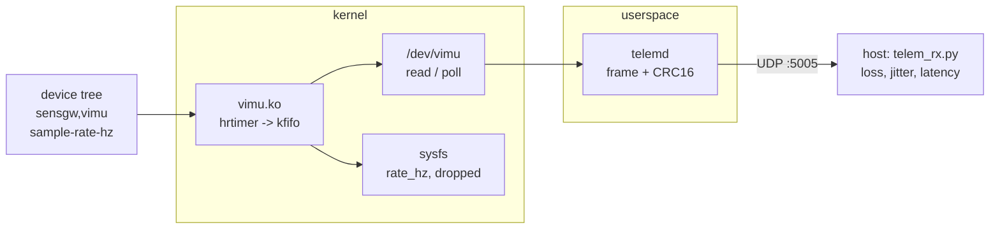

# sensor-gateway-linux

A small embedded Linux image for ARM64 that reads an IMU through a kernel
driver and streams the samples over UDP. Think of a box bolted next to a motor
or a pump that sends vibration data to a server. It is built with Buildroot
and runs in QEMU, so it can be built and tested without hardware. CI boots
every build and measures it.



## What is in here

| Path | |
|---|---|
| `package/vimu` | Platform driver. Binds to a `sensgw,vimu` DT node, samples on an hrtimer, buffers in a kfifo, blocking `read()` and `poll()` on `/dev/vimu`, `rate_hz` and `dropped` in sysfs. The sensor itself is simulated. |
| `package/telemd` | Reads the device in batches, packs each sample into a 38-byte frame with a CRC-16 and sends it over UDP. |
| `board/sensgw` | Rootfs overlay (init script), kernel config fragment, the DT node. |
| `configs/sensgw.fragment` | Applied on top of Buildroot's `qemu_aarch64_virt_defconfig`. |
| `scripts/` | Configure, build the DTB, boot in QEMU and measure. |
| `host/` | UDP receiver and report generator. |

## Frame format

Little endian, 38 bytes:

| Field | Type | |
|---|---|---|
| magic | u16 | `0x5347` |
| version, flags | u8, u8 | |
| seq | u32 | from the driver, gaps mean lost samples |
| t_sample_ns | u64 | target CLOCK_MONOTONIC when sampled |
| t_send_ns | u64 | target CLOCK_MONOTONIC right before `sendto()` |
| accel_mg | 3 x s16 | milli-g |
| gyro_mdps | 3 x s16 | milli-deg/s |
| crc | u16 | CRC-16/CCITT-FALSE over the previous 36 bytes |

## Build and run

On a Linux machine with the usual Buildroot host packages plus
`qemu-system-arm` and `device-tree-compiler`:

```sh
git clone --depth 1 -b 2025.02.x https://gitlab.com/buildroot.org/buildroot.git
sh scripts/configure.sh buildroot output
make -C buildroot O=$PWD/output
sh scripts/make_dtb.sh output/images
sh scripts/run_and_measure.sh output/images results 30
```

The last step boots the image, captures 30 seconds of data on UDP port 5005
and writes `results/results.md` with boot times, sizes and stream statistics.
QEMU's user networking maps 10.0.2.2 in the guest to the host's loopback,
which is where telemd sends by default.

Inside the guest:

```sh
cat /sys/class/misc/vimu/rate_hz
cat /sys/class/misc/vimu/dropped
cat /var/log/telemd.log
```

## Results

See the latest run in the Actions tab. Numbers come from QEMU without KVM, so
they say more about the emulator than about real hardware. They are there to
catch regressions between commits.

## License

The kernel driver is GPL-2.0, the rest is MIT. See `LICENSE`.
