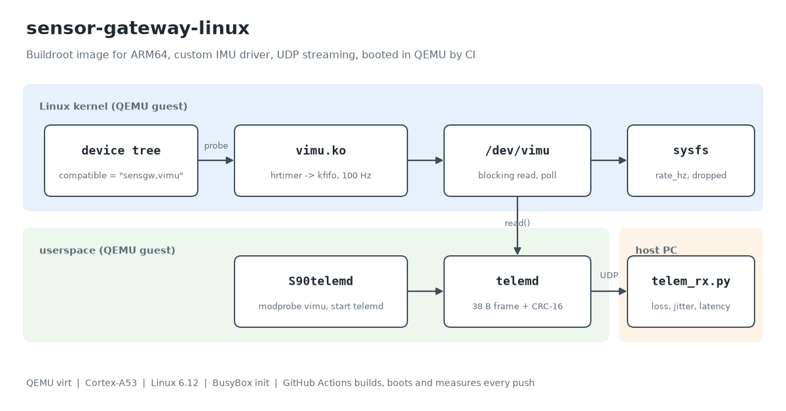
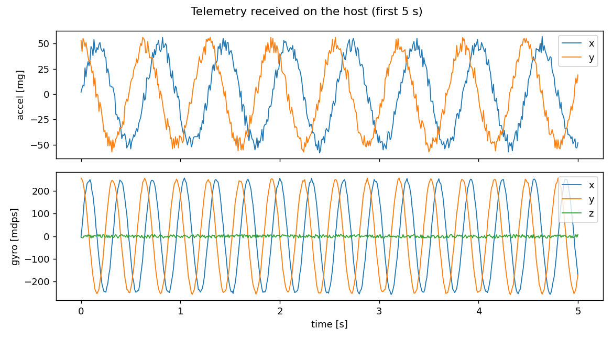
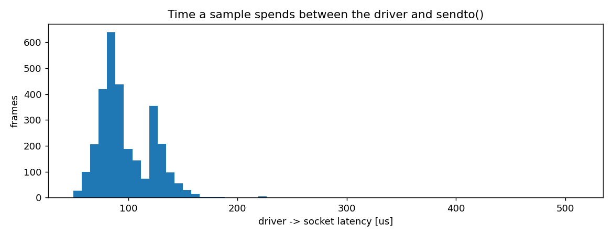

Uzun süredir mikrodenetleyici tarafında çalışıyorum: bare-metal, FreeRTOS, kesmeler, DMA. Linux tarafında ise genelde hazır bir imajın üstüne uygulama yazan taraftaydım. Bu sefer işin alt katmanını kendim kurmak istedim: imajı sıfırdan derlemek, bir sensör için kernel sürücüsü yazmak, veriyi bir servisle dışarı akıtmak ve bunların hepsini her commit'te otomatik test etmek.

Elimde kart olmadığı için her şeyi QEMU üzerinde yaptım. Senaryo basit: bir motorun ya da pompanın yanına vidalanmış, titreşim verisini sunucuya gönderen küçük bir Linux kutusu.

Kod: [github.com/cankurtaranfaik/sensor-gateway-linux](https://github.com/cankurtaranfaik/sensor-gateway-linux)



## Parçalar

**İmaj.** Buildroot'un `qemu_aarch64_virt_defconfig` ayarının üstüne kendi `BR2_EXTERNAL` ağacımı koydum. Defconfig'i kopyalamak yerine küçük bir fragment ekliyorum, böylece Buildroot sürümü değişince stok ayarlar kendiliğinden güncel kalıyor. Derleme süresini kısaltmak için Bootlin'in hazır toolchain'ini kullandım.

**Sürücü (`vimu.ko`).** Sensör gerçek değil ama sürücünün yaptığı her şey gerçek bir SPI/I2C IMU sürücüsünün izleyeceği yol:

- device tree'deki `sensgw,vimu` düğümüne bağlanıyor, örnekleme hızını `sample-rate-hz` özelliğinden okuyor,
- bir `hrtimer` ile örnek üretip `kfifo`'ya yazıyor,
- `/dev/vimu` üzerinden bloklayan `read()` ve `poll()` veriyor,
- okuyan taraf yetişemezse en eski örneği atıp sysfs'teki `dropped` sayacını artırıyor.

Zamanlayıcı kısmı şöyle:

```c
static enum hrtimer_restart vimu_tick(struct hrtimer *t)
{
	struct vimu *v = container_of(t, struct vimu, timer);
	struct vimu_sample s;
	unsigned long flags;

	vimu_make_sample(v, &s);

	spin_lock_irqsave(&v->lock, flags);
	if (kfifo_is_full(&v->fifo)) {
		kfifo_skip(&v->fifo);
		v->dropped++;
	}
	kfifo_put(&v->fifo, s);
	spin_unlock_irqrestore(&v->lock, flags);

	wake_up_interruptible(&v->wq);

	hrtimer_forward_now(t, v->period);
	return HRTIMER_RESTART;
}
```

Timer yalnızca cihaz açıkken çalışıyor; kimse okumuyorsa CPU boşuna uyanmıyor.

**Device tree.** QEMU'nun `virt` makinesi device tree'yi kendisi üretiyor, yani düzenleyebileceğim bir `.dts` dosyası yok. Çözüm: QEMU'ya `dumpdtb` ile ağacı döktürüp, onu `/include/` eden küçük bir dosyaya kendi düğümümü ekleyip `dtc` ile yeniden derlemek. Burada dikkat edilmesi gereken nokta, döküm ile asıl boot'un aynı makine ayarlarıyla yapılması; bellek ya da CPU sayısı farklı olursa ağaç makineyle uyuşmuyor.

**Servis (`telemd`).** Sürücüden 16'lık gruplar halinde okuyup her örneği 38 baytlık bir pakete koyuyor: sıra numarası, iki zaman damgası, altı eksen verisi ve CRC-16. Zaman damgalarından biri örneğin alındığı an, diğeri `sendto()`'dan hemen önceki an. Aradaki fark, bir örneğin sürücüden sokete kadar ne kadar beklediğini gösteriyor. Servis BusyBox init betiğiyle açılışta başlıyor.

**CI.** Her push'ta GitHub Actions imajı derliyor, QEMU'da açıyor, bilgisayar tarafında 30 saniye veri dinliyor ve sonuçları raporluyor. Sürücüde ya da serviste bir şey bozulursa paket kaybı ya da boot süresi hemen gösteriyor.

## Sonuçlar

CI'daki son çalıştırmadan ([run 39027156837](https://github.com/cankurtaranfaik/sensor-gateway-linux/actions/runs/39027156837)), Linux 6.12.27, tek çekirdek Cortex-A53, 256 MiB RAM:

| Ölçüm | Değer |
|---|---|
| Kernel'in /sbin/init'e geçmesi | 0,53 s |
| init'in S90telemd'ye gelmesi | 2,64 s |
| vimu sürücüsünün yüklenmesi | 2,68 s |
| İlk paketin gönderilmesi | 2,80 s |
| QEMU'nun başlatılmasından ilk paketin bilgisayara ulaşmasına | 2,94 s |
| Kernel Image / rootfs içeriği | 12,5 MiB / 7,9 MiB |
| vimu.ko / telemd | 13,9 KiB / 9,8 KiB |
| 30 saniyede gelen paket | 3002 (100,0 Hz) |
| Kayıp / bozuk paket | 0 / 0 |
| Örnekler arası süre, ortalama / standart sapma | 10,000 ms / 16 µs |
| Örnekler arası süre, en kısa / en uzun | 9,86 ms / 10,15 ms |
| Sürücüden sokete gecikme, p50 / p99 / en kötü | 91 / 157 / 511 µs |

Kernel yarım saniyede init'e geçiyor ama init'in S90'a gelmesi iki saniyeden fazla sürüyor. Bu sürenin nereye gittiğini bir sonraki adımda ölçeceğim.





Bu sayıları okurken bir şeyi unutmamak lazım: QEMU burada KVM olmadan, ARM komutlarını yazılımla çevirerek çalışıyor. Yani mutlak değerler gerçek bir Cortex-A53 kartını temsil etmiyor. İşe yaradıkları yer commit'ler arası karşılaştırma: bir değişiklik gecikmeyi ya da boot süresini bozarsa CI bunu yakalıyor.

## Sırada ne var

- Gerçek bir sensör için IIO sürücüsü (I2C, QEMU'da emüle edilen bir cihazla)
- A/B bölümlü, geri dönebilen OTA güncelleme
- Boot süresini kısaltma: hangi adım ne kadar sürüyor, neyi atabilirim
- Aynı ölçümü PREEMPT_RT kernel ile tekrarlayıp gecikme dağılımını karşılaştırmak

Her adımı ayrı bir yazı olarak buraya ekleyeceğim.
